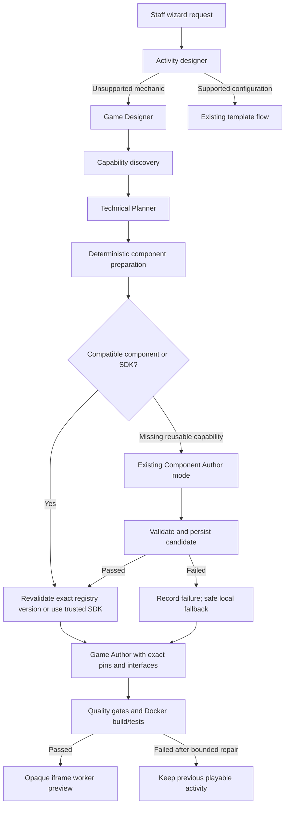

# Automatic component generation — verification and integration

Implemented and verified on `AI_workflow`, 2026-11-09. No new AI role, orchestration framework, dependency, external-code download or trust promotion was introduced.

## What existed before this task

The automatic integration was **missing**, while its underlying services already existed. Source was inspected before changes; the initial findings are recorded in `tasks/automatic-component-plan.md`.

| Question | Verified initial behavior |
|---|---|
| Did Discovery identify missing capabilities? | Yes. `discoverComponents` in `server/generation/discovery.ts` returned reuse/adapt/generate recommendations. |
| Did the Planner distinguish reusable components from game glue? | Not structurally. `planSchema.components` described proposed systems, but had no reusable ComponentSpec/task versus local-behavior contract. |
| Did normal generation call `generateComponent`? | No. `authorProposal` in `server/generation/pipeline.ts` discovered and loaded existing registry entries only. Actual generator callers were component jobs, developer scripts and tests. |
| Were components validated and persisted? | Yes, when explicitly requested through the component job/CLI path: `generateComponent`, `saveCandidate`, `validateComponent`. |
| Could games link existing components? | Yes. `loadForReuse` revalidated exact versions and the pipeline attached pinned modules to `linkedComponents`. |
| Could a normal wizard create a missing reusable component and use it immediately? | No. Missing game behavior went directly to the Game Author and remained game-local. |

The previous [registry evidence](COMPONENT-REGISTRY-EVIDENCE.md) explicitly described the developer-only authoring entry point. This task connects it to the normal game workflow rather than recreating it.

## Current execution path



`src/studio/api.ts::askAgent` submits `/api/agent`. `server/index.ts` routes unsupported requests to `startGeneration`. The existing `authorProposal` now calls `prepareComponents` after planning and before game authoring. No component CLI/API request is needed from the staff member.

## Changes and trigger conditions

- `src/engine/generation.ts`: optional backwards-compatible `componentTasks`, `localBehavior` and `componentWork` schemas. The normal Planner model response explicitly requires reusable/glue fields and structured requirements.
- `server/generation/component-work.ts::mergeRequirements`: retains original Designer capabilities/quality floors and merges same-kind Planner refinements. Dropping refinements would hide capabilities needed by a task.
- `prepareComponents`: accepts at most two explicit Planner tasks with a declared requirement, matching capability subset and supported mechanic/visual interface. Mechanics need parameterization; input adapters, undeclared work and quality levels beyond the automatic candidate tier are not generated. A missing string alone is not a trigger.
- Preparation rechecks the registry before each task. Compatible validated/approved versions are revalidated without invoking the generator. Fully supplied SDK/artwork capabilities are skipped. Only genuinely missing reusable capabilities call the existing `generateComponent`, with at most two author attempts per automatic task. Exact duplicate or overlapping missing-capability work is not repeated within the request.
- `matchesComponent` checks versioned interface, canonical capabilities, interaction requirements and parameter names/types. Mechanic/interaction/animation labels may share the same worker interface; visual/asset entries use the distinct declarative interface. Classification labels alone do not make code compatible.
- Discovery now reports structured `missingCapabilities`; layout/label gaps no longer falsely imply that existing flower artwork is unavailable. Reviewed capability aliases cover actual alternate dwell/contact/tracking-loss wording seen in live requests.
- `codexAuthor.plan`: receives persistent interface/parameter metadata and has bounded schema/placeholder-plan repair. `codexAuthor.code` receives exact module metadata plus reference source for correct composition and preparation failures for fallback. Model-owned linked dependency source is omitted from its output schema and overwritten by the host.
- `missingComponentImports` requires actual runtime imports/re-exports of supplied mechanics. Comments and type-only imports do not satisfy the check. This is a structural reuse gate, not a proof of correct calls; tests and runtime behavior remain necessary.
- Client polling allows 30 minutes for the bounded multi-stage path. Individual model/container deadlines and resource restrictions remain unchanged.

## Persistence, linking and failure handling

The existing registry stores immutable content objects separately from version metadata. New components become candidates, then validated versions after successful checks. Preparation refreshes discovery, revalidates selected versions and attaches the exact ID/version/hash/source to the game bundle. Visual definitions likewise come from validated registry payloads and are rendered only by trusted host primitives. The final compiled bundle contains the pinned mechanic implementation.

`discovery-before-components.json`, `component-generation.json`, `plan.json`, refreshed discovery and final proposal/artifact files preserve the trace under `.careplay/proposals/<id>/`. `componentWork` records generation calls, author attempts, successful pins, skipped work and safe diagnostics. Plans are persisted before component authoring so failures remain reviewable.

Generation, validation or reuse failures do not link unvalidated source. Failures are recorded and passed to the Game Author, which may implement safe local behavior within the existing contract. Missing required visual artwork cannot be replaced with invented IDs. The final game still passes the ordinary quality/Docker/runtime gates. Provider quota/authentication/timeouts stop further automatic component expenditure within that request. Overall failure leaves the previous game unchanged.

Validated and approved generated code both remain inside Docker and the opaque iframe worker. Staff acceptance never grants developer approval or host execution. No generated code is copied into trusted source directories. The existing kernel/browser/denial-of-service residual risks documented in [ISOLATED-PREVIEW.md](ISOLATED-PREVIEW.md) remain; this integration adds no stronger sandbox claim.

## Live Test A: automatic creation

Normal staff wizard request: Flower Pause Garden, three stationary flowers, 1.2 seconds of uninterrupted palm contact, reset partial contact on loss/exit, shared progress, completion and replay. At the start there was no validated dwell-selection component.

- Successful game proposal: `676c58dc-ff4d-4e74-be8c-f90eeec37377`.
- Initial discovery identified missing dwell capabilities; the Planner proposed a generic parameterized task.
- The normal pipeline invoked the Component Generator once, with two author attempts. First component version failed TypeScript test narrowing; the repaired version passed **11 generated tests** and generic runtime probes.
- Persisted component: `dwell-selection@2`, SHA-256 `1371886c35f576342061c1526720e0c3064768544db69b4a4fe2f075d2270797`.
- Exact version was revalidated and imported by the Game Author. Its implementation also appears in the compiled browser bundle, rather than only in manifest metadata.
- Game authoring passed on its first attempt with **10 generated tests** in real Docker.
- Browser play rejected a short touch, reset partial contact after tracking loss, completed all three targets after sustained contact, displayed completion, replayed and saved.

No manual component-generation command or generated-source editing was used. Only local video/hand landmarks were synthetic; the wizard, model calls, component services, Docker, generated worker and renderer were real.

## Live Test B: automatic reuse

Normal second wizard request: Quiet Fish Pond with the same sustained-contact behavior and existing fish artwork.

- Successful proposal: `5b9e55c9-5560-46cf-91e7-2f3b5922676b`.
- Discovery retrieved the stored component. `plan.componentTasks` and `componentWork` were empty: **zero Component Generator calls**.
- `linkedComponents` pins the identical v2/hash from Test A. The existing source was revalidated and composed, not regenerated.
- Game authoring passed on its first attempt with **10 generated tests** in Docker.
- Browser checks passed short-touch rejection, tracking-loss reset, three sustained selections, completion, replay and save with the fish theme.

Both games use validator image `sha256:38be40c654a22044d845fcf84dce16ac898948c9cf398230ca4d4f998bdb74a7`, with contract/runtime/harness fingerprint `14ec061f08a8172bb21155e98279290313f6c6b1453ac0ef7ba30ab83c292f1a`. The runtime/image did not need weakening or replacement for this integration.

Raw ignored local evidence: `artifacts/automatic-components-live.json`, `automatic-flowers.png`, `automatic-fish.png`, component version metadata/objects and both proposal folders. Screenshots were inspected manually. This is not automated model screenshot review or physical resident testing.

### Diagnostic history, not hidden successes

The first pilot `c8b63d0f-959c-4ef7-9828-6dcb732e803d` exposed discarded Planner refinements and a false missing-art diagnosis. It was stopped, and the merge/quality logic was fixed. A subsequent first reuse pilot `51c5a50a-00d3-446b-b0a5-0860d64598a1` built a game but failed the reuse assertion: alternate capability wording prevented linking, and its plan contained placeholder acceptance text. It is **not** counted as successful reuse. Canonical retrieval and Planner validation were corrected, then Test B was rerun through the wizard using the retained Test A evidence. Neither generated source was manually patched to manufacture a pass.

## Commands and actual results

```powershell
npm test
npm run build

$env:CAREPLAY_TEST_DOCKER='true'
$env:CAREPLAY_TEST_COMPONENTS='true'
$env:CAREPLAY_TEST_COMPLETE_ARTIFACTS='true'
node --env-file-if-exists=.env --import tsx --test server/component-integration.test.ts

$env:CAREPLAY_TEST_AUTOMATIC_COMPONENTS='true'
npx playwright test tests/automatic-components-live.spec.ts
# After Test A has been retained locally, continue only the second wizard scenario:
$env:CAREPLAY_TEST_AUTOMATIC_REUSE_ONLY='true'
npx playwright test tests/automatic-components-live.spec.ts
```

- Unit suite: **41 passed**, six opt-in tests skipped. Five new deterministic orchestration tests cover automatic generation/reuse, duplicate prevention, failure/invalid-output fallback, incompatible parameters, visual task dispatch, requirement merging, placeholder plans and real import requirements. Mocks are explicitly identified as mocks.
- Explicit real-Docker integration suite: **5 passed**. Covers immutable compiled tests, existing Fruit Sorting/Fish Feeding full lifecycle/replay, exact source ownership and safe local fallback after an injected provider failure. These are trusted author fixtures and existing-artifact regressions, not additional live AI generation claims.
- Focused browser regressions: **4 passed** (real complete-artifact accessibility, discovery HTTP, editor integration, opaque-origin/watchdog).
- Test A passed generation and browser assertions in the first combined live run; that command correctly failed on the initial Test B reuse assertion. The corrected reuse-only continuation **passed in 3.0 minutes**, retaining the real Test A record. The combined JSON now records both successful normal-wizard scenarios.
- Production build passed. The pre-existing large BalloonScene chunk warning remains.

## Remaining limitations

Retrieval is deterministic capability metadata plus reviewed aliases, not general semantic search. Planner quality, novel state contracts and custom mechanics still require meaningful tests; generic smoke probes cannot prove every future game. Automatic generation is capped at two reusable tasks and two author attempts each; excess or failed work may stay local or fail safely. Approval remains a developer decision. Transitive generated dependencies, arbitrary rendering, paid asset generation and external runtime adapters remain unavailable. Transient hand IDs do not guarantee resident identity or continuity when hands cross. Physical webcam/resident validation remains manual.
