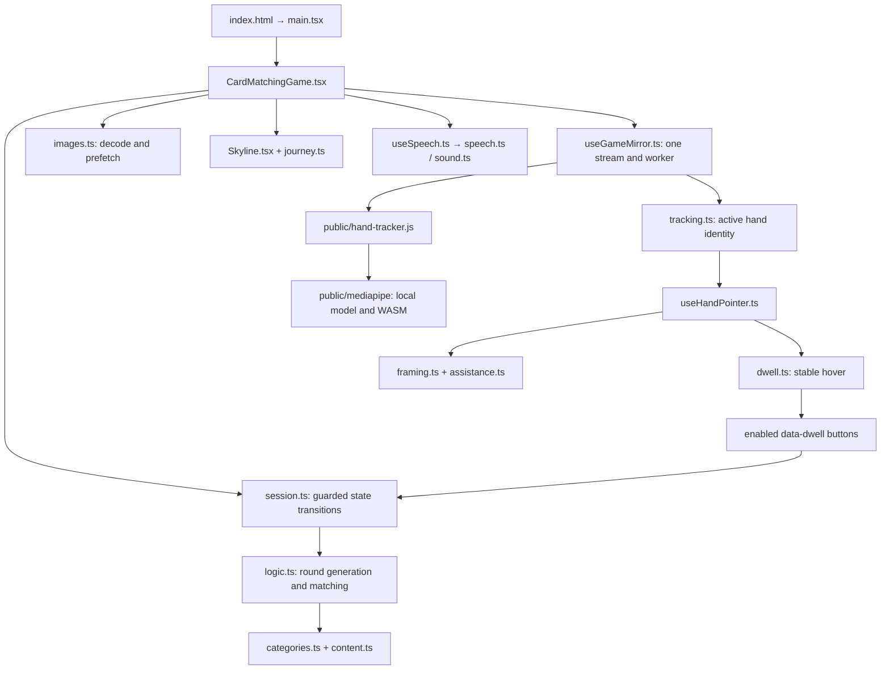
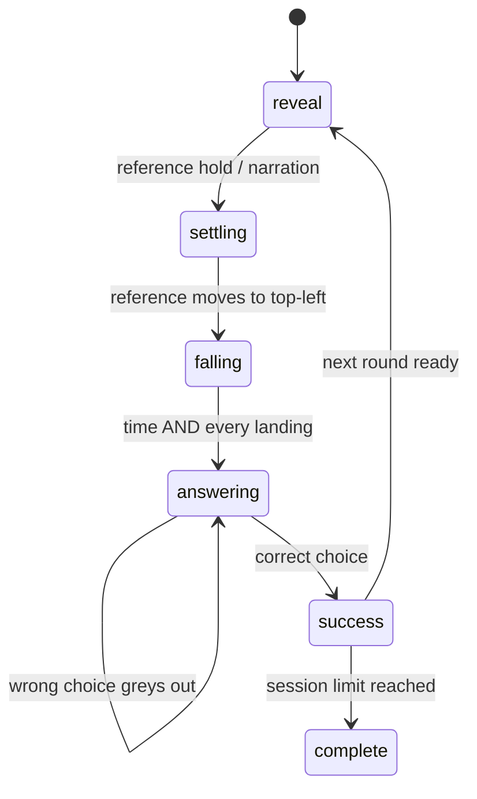
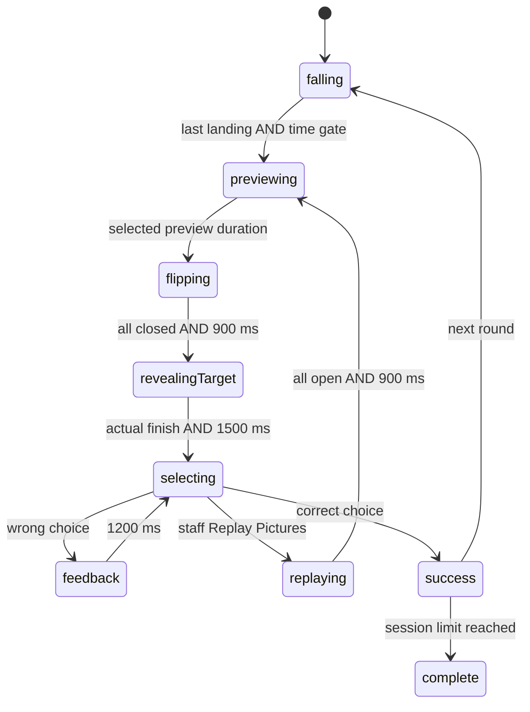

# Architecture

This guide describes the Phase 6.4 implementation. Start with the [README](README.md)
for user-facing behaviour and [TESTING](TESTING.md) for verification. Paths in this
guide are relative to this game folder unless a repository-root path is specified.

## System boundaries

The application shares the root package/tooling and public worker assets with
Balloon Popper. It does not mount Balloon Popper's components or share its live
camera instance. [INTEGRATION_GUIDE](INTEGRATION_GUIDE.md) explains the distinction
between shared files and a future shared runtime owner.

## React organisation

- [main.tsx](main.tsx) mounts the game in React Strict Mode; [index.html](index.html)
  is the independent Vite development entry.
- [CardMatchingGame.tsx](CardMatchingGame.tsx) owns Home/setup preferences, active
  session, staff dialogs, the persistent video, decoding readiness, narration,
  reference animation and input dispatch. `Face`/`Options` are local UI helpers.
- [CardMatchingGame.module.css](CardMatchingGame.module.css) scopes presentation.
  The hand cursor is portalled to the open dialog or document body and retains its
  module class, so it can remain visible above dialogs.
- [Skyline.tsx](Skyline.tsx) is memoised vector artwork; [journey.ts](journey.ts)
  maps correct matches to sections/stage names.
- [TrackingPanel.tsx](TrackingPanel.tsx) offers staff hand selection and diagnostics.

There is no external state library. React handles meaningful visual transitions;
refs hold the current reducer session, camera results and pointer runtime. A single
100 ms interval advances the game clock. It skips paused/hidden/loading states and
only publishes ticks for phase changes, close-soon changes or idle-second changes.
The React session snapshot is therefore not a frame-by-frame clock API.

## State model and round generation

[session.ts](session.ts) defines `Session`, `Event`, `newSession`, `updateSession`
and `canSelect`. All answer paths dispatch `choose`; the reducer accepts only
unpaused `answering` or `selecting`, a current known answer and a non-rejected ID.
Disabled buttons are a second UI guard, not the sole protection.

[logic.ts](logic.ts) builds four unique choices with exactly one matching ID.
It avoids the preceding reference and correct slot, favours least-used/familiar
references, shuffles distractors, and honours incompatible visual choices. The
reference must also be present among the answers. A prepared round is checked
before adoption. Session history is bounded; no resident account is stored.

### Level 1

Reveal holds for 1800 ms, subject to narration; normal reference movement is
1500 ms. Each descent is 1500 ms with 400 ms stagger (2700 ms total). All four real
landing completions and the clock are required. Reduced motion uses a short static
entry rather than artificial falling. Answers remain available without a countdown.

### Level 2 and replay

The target is absent from the UI and unspoken through falling, preview and closing.
Preview lasts Brisk 8000 / Standard 10000 / Relaxed 14000 ms **after** the final
landing/opening. `closingSoon` changes once in the final three seconds, producing
a text cue without a countdown. `motion`, `phaseDuration` and `gamePaces` centralise
timing. Pause retains elapsed time; pace changes made while paused alter the total,
not the elapsed time. Reduced motion retains preview/open/close/target input locks.

A replay preserves `round`, answer order, question, history, number, rejected choices
and journey. `shown` records currently opened choices separately from `rejected`;
replay can therefore close all four cards without losing previous rejections.
`openingFrom` prevents a previously open wrong card jumping when replay starts.
Busy replay requests are ignored. There is no per-replay timer allocation.

Monotonic round `revision` values reject obsolete round callbacks, including after
Home/Restart. A separate `cycle` changes for replay, so queued callbacks from a
previous animation of the same question cannot satisfy a new barrier. Opening,
landing, closing and target completion are accepted only in their corresponding
phase. Paused completions cannot unlock input until the clock resumes.

Inactivity advances only while selecting/answering; animations and replay do not
consume it. Target completion resets it for a full answer allowance. Correct and
wrong choices reset idle activity; Home retains tracking and End stops resources.

## Tracking and camera lifecycle

[useGameMirror.ts](useGameMirror.ts) is game-local. It requests video only, assigns
one stream to one mirrored video and starts the existing classic worker at
repository-root [public/hand-tracker.js](../../../public/hand-tracker.js). Init is
`{type:'init', base:location.origin, hands:2}`. Frames are `ImageBitmap`s with a
capture timestamp; results contain landmark arrays or an error.

The existing worker runs MediaPipe Hand Landmarker in VIDEO mode with the CPU
delegate, a maximum of two hands and its configured detection/presence/tracking
thresholds. The adapter caps capture attempts to an 80 ms minimum interval,
downscales to 640 pixels wide, avoids duplicate video times and permits one frame
in flight. The worker closes each received bitmap in `finally`; stale adapter
runs close a bitmap before transfer. This is not a guarantee of actual inference FPS.

[tracking.ts](tracking.ts) associates hands geometrically using position/motion,
then selects one controlling hand. It can prefer a consistently moving second hand,
locks identity during dwell, and fails closed on ambiguous overlap or disappearance.
It does not identify people or infer an unseen phone-occluded hand. Staff can assign
or reselect an active hand. Only that selected identity is smoothed; nearby hands
cannot borrow each other's filtered position.

`stop()` increments a generation token, terminates the worker, stops tracks,
detaches the video, clears frame/selector state and hides the pointer through hook
cleanup. Restart/device replacement stops the former owner before creating another.
Failure timeouts and stale asynchronous results are generation-guarded. Camera
capture RAF callbacks exit when their run is obsolete; pointer RAF/listeners and
observers are explicitly cancelled on cleanup. Strict Mode's mount/cleanup cycle
must remain safe. Browser visibility loss pauses gameplay; Resume is a staff action.

## Coordinates, hit testing and dwell

[framing.ts](framing.ts) calculates the exact mirrored `object-fit:cover` position
including aspect-ratio crop and staff object-position pan. The main video fills
the viewport; Home contains the preview. Default gameplay mapping follows the
visible palm literally. Off-crop palms cannot activate answers in aligned mode.

[assistance.ts](assistance.ts) normalises and clamps a comfortable seated reach
around an ephemeral calibration. Home/dialogs use assisted menu reach. Recenter
explicitly enables assisted reach; staff can restore Mirror aligned in Camera
Settings. The small palm marker remains tied to displayed video geometry. Do not
calibrate the crop transform itself or assume source coordinates equal screen pixels.

[useHandPointer.ts](useHandPointer.ts) updates DOM/SVG properties through RAF,
not React state. It rejects stale frames, caches visible `[data-dwell]` rectangles,
refreshes on relevant DOM/viewport changes and chooses the nearest overlapping
candidate using a small hit margin. This is point-in-rectangle UI selection,
separate from Balloon Popper's balloon/palm/fingertip collision model.

[dwell.ts](dwell.ts) handles fresh duration and consumed-target blocking. Scene
changes require deliberate movement from the **new mapped point**, preventing a
stationary physical palm from activating a dialog after mapping changes. Phase,
cycle, revision and pause reset dwell. In memory selection, a held-over answer is
blocked until leave/re-enter or movement to another card; then a new dwell of at
least 1000 ms is required. The ring and hover border are imperative visual feedback.

[mirror.ts](mirror.ts) retains a legacy helper using runtime `mapToMirror` from
repository-root [src/game/logic.ts](../../game/logic.ts), primarily exercised by
regression tests. Current gameplay uses `framing.ts`, not that helper. Other
cross-folder imports are types (`Point`, `HandFrame`, `TrackedHand`) from existing
Balloon/camera modules. Keep these distinctions clear when extracting shared code.

## Animation, rendering and audio

Each answer keeps its decoded front/back nodes on one 3D rotor throughout the
round; backface visibility and `aria-hidden` prevent double-facing content and
accessible hidden labels. CSS transforms coordinate descent and flips. The target
uses Web Animations for opacity/scale and a waypoint below the instruction before
moving up at the left. Target content mounts only when permitted, with a fade to
avoid a full-opacity jump. Success holds then fades the row/reference; the skyline
stays mounted. Pausing freezes CSS animations, running transitions and target WAAPI.

[images.ts](images.ts) caches decode promises and prefetches the next round. Camera
frames, pointer samples and smoothing do not require per-frame React renders.
See [PERFORMANCE.md](PERFORMANCE.md) for measured results and native/GPU limits.

[useSpeech.ts](useSpeech.ts) manages compatible local English voices, late
`voiceschanged`/bounded discovery retries, cancellation generations, playback
watchdogs, rate/volume and clear diagnostics. [speech.ts](speech.ts) selects voices
by language/local metadata and supports static local recordings ahead of system
speech. External recording URLs/network voices are rejected. [sound.ts](sound.ts)
provides optional local positive feedback. Home cancels current speech/sounds;
End stops them and camera resources. No human recordings currently exist; the
[recording guide](RECORDINGS.md) and manifest describe future work, not supplied audio.

## Extending safely

Add category data through [categories.ts](categories.ts)/[content.ts](content.ts),
with unique IDs, English labels, at least four compatible choices, locally bundled
images or swatches, and complete licence/author/source records. Use static Vite URLs
so builds include assets. Review familiar vocabulary and conflicts with RCA staff.
Update English recording manifest entries and category/round tests. Legacy `zh`
metadata does not enable another language; current runtime is English only.

For a new gameplay feature, first add reducer events/guards and tests; then wire UI
and narration only to authorised phases. Preserve pause, full idle allowances,
cleanup, replay tokens and explicit input gating. Run both games' regressions.
Do not mount both camera hooks to implement navigation; use the future ownership
contract in [INTEGRATION_GUIDE.md](INTEGRATION_GUIDE.md).
